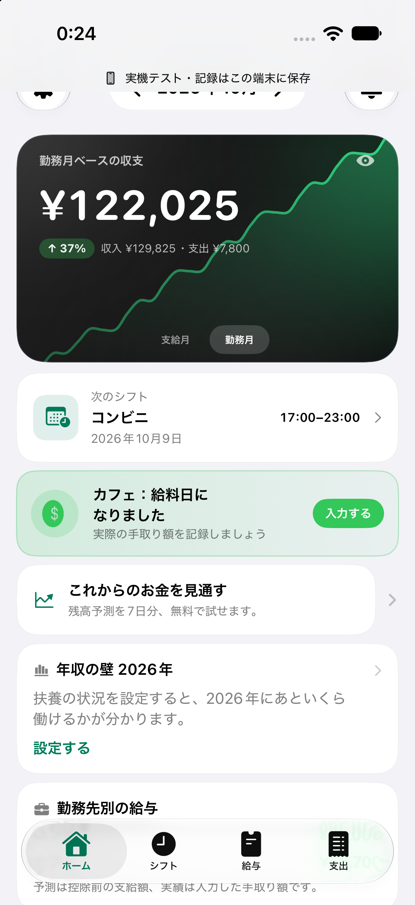
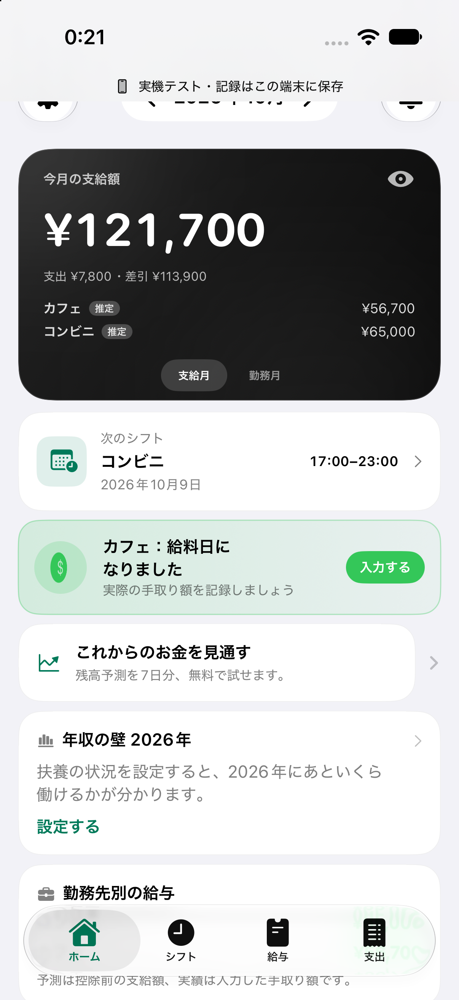
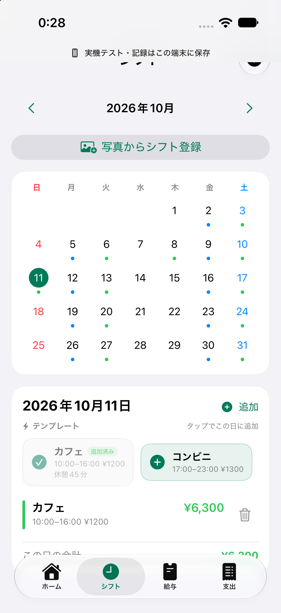
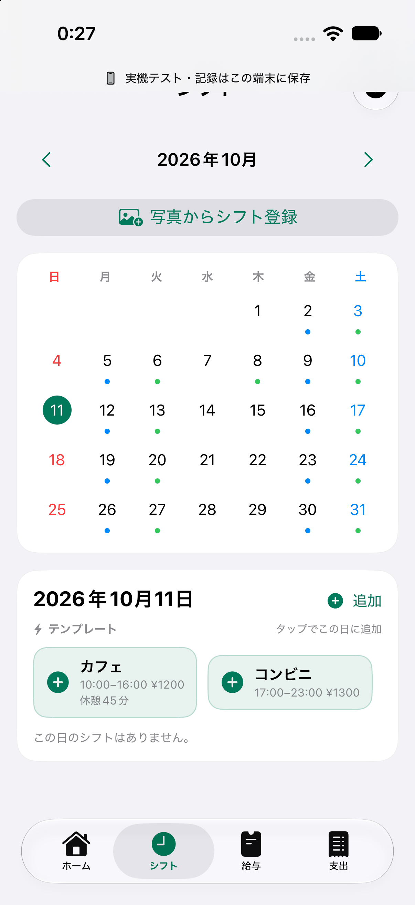

# Shift Builder

English · [日本語](README.md)

**Add your shifts. Look forward to payday.**

An iOS app designed for students and hourly workers who want to keep track of their own shifts and earnings, including multiple part-time jobs. A clear home screen, a payday animation, and one-tap shift templates aim to make entering shifts easier and checking your progress more rewarding.

**Development status:** Not yet available on the App Store. The current build uses Japanese yen and Japan-specific pay calculations. English UI coverage is partial; an international version is planned, not implemented. [International launch plan](docs/INTERNATIONAL.md)

## Three details that shape the experience

<table>
<tr><th>A home screen worth opening</th><th>A little payday celebration</th><th>One-tap shift entry</th></tr>
<tr>
<td></td>
<td></td>
<td></td>
</tr>
</table>

The screenshots show the current Japanese interface and yen amounts. All sample employers, shifts, and amounts are fictional.

### See what your work adds up to

The dark home card shows the month's pay and its breakdown by employer. Switch cards to see income, expenses, and a chart for the month worked. A button hides amounts when checking your schedule in public, and your next shift is close at hand.

### Make payday a moment to remember

A rotating coin banner appears on an employer's payday. From the banner, enter your actual take-home pay and reflect it on the home screen. The animation connects seeing the result of your work with recording what you received.


### Pick a date. Tap your usual shift.

Recent shift patterns become reusable templates. Select a date and tap a template to add its employer, hours, wage, and break settings. A checkmark identifies an already-added pattern and prevents adding that same template twice on the date.



These images were captured from the implemented SwiftUI app in a simulator. The template GIF alternates between the actual screens before and after one tap. These features are implemented; their effect on motivation and retention has not yet been tested with users.

## Other implemented features

- A calendar for shifts across multiple employers, repeated shifts, and pre-shift reminders.
- Estimated pay using hourly rates, unpaid breaks, premium settings, pay periods, and paydays; actual pay records are kept separately.
- Balance projections using expenses, recurring expenses, and expected deposits. The current free/Plus feature split is 7 days versus 90 days.
- A comparison of estimated pay after adding or removing one shift, without changing the saved schedule.
- Photo-to-shift import with review and editing before saving. Apple Vision processes images on the device.
- Account-scoped cloud sync, offline editing, and conflict visibility.

The current payroll, withholding, holiday handling, and income-limit features are Japan-specific. Projections are estimates based on entered information. There is no bank integration. Photo import accepts personal lists with one date and one time range per line; broad staff grids and AM/PM formats are not supported. Review imported candidates against the original image.

## Technology

| Area | Implementation |
| --- | --- |
| Interface | SwiftUI, Swift Charts, PhotosPicker, dark mode, Japanese and partial English UI |
| Calculations | Independent Foundation-based Swift package: `PayrollEngine` |
| Photo recognition | On-device Apple Vision; images and recognized text are not uploaded to an external AI service |
| Authentication and sync | Firebase Auth, Firestore, Google Sign-In, Sign in with Apple |
| Purchases | StoreKit 2 and StoreKit Testing; access is derived from verified transactions |
| Verification | XCTest, Swift package tests, and dedicated Firestore Emulator tests |

Additional documentation is currently in Japanese: [UI and UX design](docs/DESIGN.md), [architecture](docs/ARCHITECTURE.md), [validation scope](docs/VALIDATION.md), and [source/demo data handling](docs/PRIVACY.md).

## Run the local demo

The development verification environment used Xcode 27 and an iOS 27 simulator. The deployment target is iOS 17 or later. External dependencies are resolved with Swift Package Manager.

```sh
git clone https://github.com/ichiha4/shift-builder.git
cd shift-builder
python3 scripts/setup_local_demo.py
open ShiftManagerApp/ShiftManagerApp.xcodeproj
```

1. Select the **ShiftManagerApp-LocalDevice** scheme.
2. Select an iPhone simulator and run the app.
3. This configuration skips sign-in and stores records locally. Add an employer and shifts, or try the sample image in photo import.
4. To test Plus, use `ShiftBuilderPlus.storekit` as the Run action's StoreKit Configuration; the shared scheme already includes it. Local purchase testing does not charge real money.

The setup script generates placeholder Firebase configuration only when needed and does not overwrite an existing configuration. The placeholder cannot provide authentication or cloud sync in the normal scheme. To run on your own iPhone, change the bundle identifier and configure your Personal Team for the LocalDevice configuration. [Setup details, in Japanese](docs/SETUP.md)

## Tests

The calculation package can be tested without Firebase or an iPhone:

```sh
cd PayrollEngine
swift test --jobs 1
```

The iOS test target covers local storage, subscriptions, sync logic, and OCR. Firestore connection tests run only when the dedicated emulator is enabled.

Previously recorded development results: 139 calculation tests passed; 38 iOS tests passed and 4 Firestore Emulator tests were skipped. Those runs preceded sanitizing the public copy's settings; they are not a fresh full test run against this public repository.

## Release direction

The planned model is free core features plus optional Plus. Prices and the final paid feature set are not decided. The first step is to test whether people want to replace their current method with this experience, and then observe use through a pay cycle. No user retention, paid demand, or revenue has been established.

Production Firebase configuration, signing team identifiers, actual device identifiers, credentials, build outputs, and backups are excluded from this repository. App Store Connect, TestFlight/Sandbox, and end-to-end real-device verification remain unfinished.
