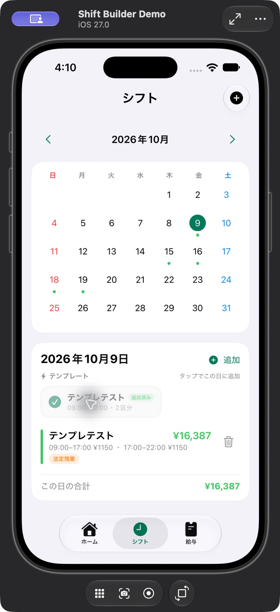
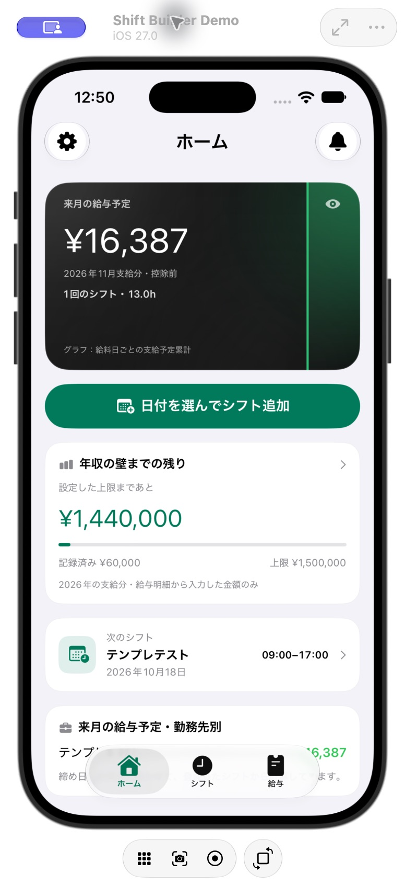
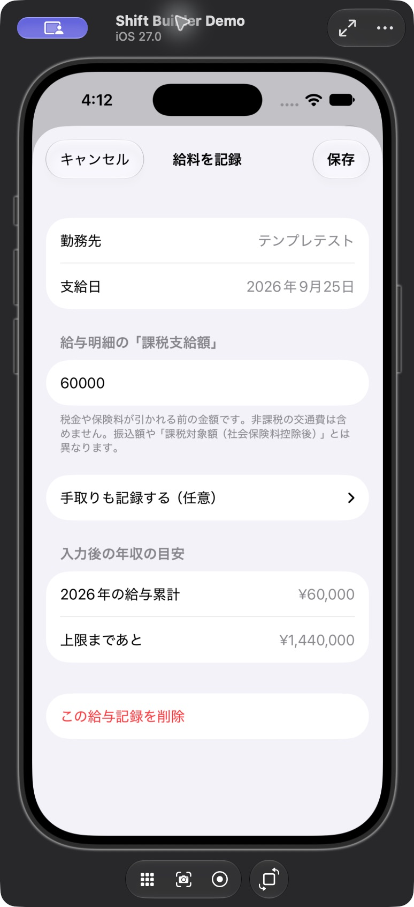
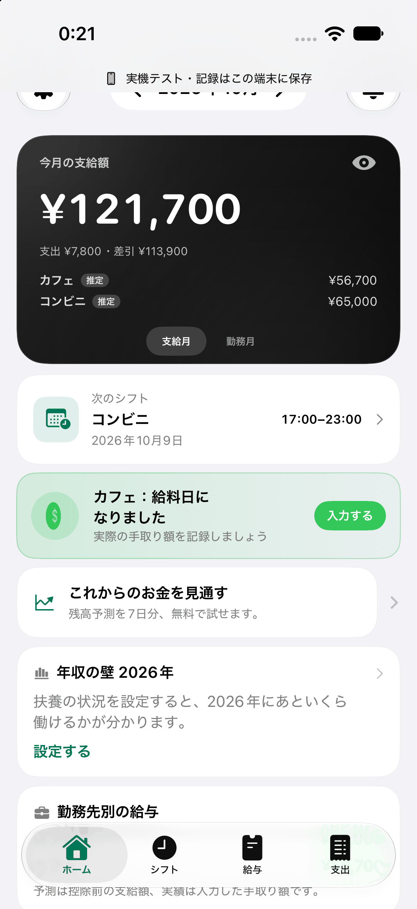

# Shift Builder

[English](README.en.md) · 日本語

**日付を選ぶ。テンプレートをタップ。シフト登録、完了。**

アルバイトをする高校生・大学生・フリーターのための、シフトと給与を確認するiOSアプリです。毎回フォームを埋めずにシフトを追加し、ホームで来月の給与予定を確認。給料日には実際の給与を入力し、自分で設定した年収の上限までの残りを見られます。掛け持ちの勤務先にも対応しています。

## 使い続けたくなる3つの工夫

### 1. 日付を選んで、いつものシフトをワンタップ

「テンプレートを作成」から、勤務先・時間・時給・休憩などを日付なしで保存できます。同じ勤務先でも、午前・午後など時間が違うパターンを複数作れます。作成だけでは実際のシフトや給与予定は増えません。

**カレンダーで日付を選択 → テンプレートをタップ**で勤務の保存まで完了。勤務時間が重ならなければ確認フォームを挟まず、そのまま別の日にも続けて追加できます。手入力したシフトのパターンも再利用でき、明示的に保存したテンプレートは勤務を削除しても残ります。[作成画面](docs/screenshots/template-create-current.png)

プラスから手入力するときは、勤務先は空欄から始まります。登録した勤務先とシフト履歴の勤務先から選ぶか、新しく名前を入力できます。給料日が未設定の勤務先も、候補から消えません。

シフトの削除もゴミ箱を1回タップするだけ。月表示のすぐ上に出る、枠付きカードの「元に戻す」から5秒間復元できます。「あと○秒」と短くなるバーで残り時間が分かり、連続削除した場合は5秒から数え直して、表示された件数をまとめて戻せます。[操作画面](docs/screenshots/delete-undo-current.png)

追加済みのパターンはチェック表示になります。勤務時間が重なるパターンも選べますが、既存のシフトと確認画面を表示し、「追加する」を選んだ場合だけ保存します。手入力・編集も同じ確認を行い、重なった勤務も給与予定に含めます。連続入力中にボタンの位置が動かないよう、テンプレートの順序を固定しています。[重複時の確認画面](docs/screenshots/overlap-confirmation-current.png)

### 2. ホームを開くと、来月の給与予定が見える

黒を基調にしたカードに、登録したシフトから計算した**来月支給される給与予定**を大きく表示します。勤務先ごとの締め日・給料日・休日調整を使い、勤務月の単純合計と区別します。グラフは給料日ごとの支給予定累計。金額を隠すボタンと、次のシフトへの導線も用意しました。

<table>
<tr><th>日付 → テンプレートで保存</th><th>来月の給与予定</th></tr>
<tr>
<td></td>
<td></td>
</tr>
</table>

2026-10-16〜19のローカルデモ構成をシミュレータで撮影した実画面です。勤務先・シフト・金額・年収の上限はすべて架空のテスト用データです。上限のサンプル金額は、特定の人に適用される制度上の基準を示しません。

### 3. 給料日には、入力して年収の残りを確認

給料日には、コインが回転するバナーで知らせます。給与明細の「課税支給額」を入力すると、今年支給された給与の累計と、自分で設定した上限までの残りを更新します。手取りの振込額は、必要な場合だけ別に記録できます。



年収の画面は実際に入力した給与だけを合計し、シフトからの見込みは加えません。以前の手取りだけの記録も自動で年収に読み替えません。税金の扶養などで確認したい上限は本人が設定します。健康保険の扶養を、この暦年の累計だけで判定する機能ではありません。

<details>
<summary>給料日のアニメーション（以前のUIでの撮影）</summary>



アニメーションは維持しています。GIFは2026-10-08の旧画面構成で、カードの表示内容や入力欄は現在と異なります。

</details>

設計の意図は [UI・UXの設計](docs/DESIGN.md) にまとめています。

## シンプルにするための方針

主な画面は**ホーム・シフト・給与**の3つです。勤務先登録は名前・時給・締め日・給料日を中心に、手当や割増などは詳細設定にまとめました。給与画面も支給予定・給料日・入力した給与を先に見せ、細かい計算は任意で確認できます。

現在の通常導線にはサブスク登録、残高予測、写真からの登録を置いていません。まず手入力とテンプレートで、迷わず確実に使える体験を優先します。これらの試作ソースは開発履歴として残っていますが、現行の提供機能として紹介していません。以前の支出記録は設定から確認できます。

## 技術構成

| 領域 | 技術・設計 |
| --- | --- |
| UI | SwiftUI、Swift Charts、ダークモード。日本語を中心に、英語は部分対応 |
| 計算 | Foundationベースの独立したSwiftパッケージ `PayrollEngine` |
| 給与記録 | 支給日別の課税支給額と任意の手取り額を分けて保存。旧データを保持 |
| 同期・認証 | Firebase Auth、Firestore、Google Sign-In、Sign in with Apple |
| 検証 | XCTest、Swift Packageの単体テスト、Firestore Emulator用テスト |

設計は [docs/ARCHITECTURE.md](docs/ARCHITECTURE.md)、確認範囲は [docs/VALIDATION.md](docs/VALIDATION.md) にまとめています。

## ローカルデモを動かす

開発時の検証環境はXcode 27／iOS 27シミュレータです。対象OSはiOS 17以降。外部依存はSwift Package Managerで取得します。

```sh
git clone https://github.com/ichiha4/shift-builder.git
cd shift-builder
python3 scripts/setup_local_demo.py
open ShiftManagerApp/ShiftManagerApp.xcodeproj
```

1. Schemeを **ShiftManagerApp-LocalDevice** に設定し、iPhoneシミュレータでRunします。
2. シフト画面の「テンプレートを作成」で、勤務先・時間・時給を保存します。
3. カレンダーで勤務する日を選び、テンプレートをタップして追加します。
4. 給与画面で実際の給与を入力。ホームの年収カードから、自分の上限を設定できます。

この構成はログイン不要で、データをローカルに保存します。通常構成は認証とFirebase設定が必要です。セットアップスクリプトはダミー設定を生成し、既存のFirebase設定は上書きしません。ダミー設定で通常構成の認証・同期は利用できません。[セットアップ](docs/SETUP.md)

## テスト

```sh
cd PayrollEngine
swift test --jobs 1
```

2026-10-17に、公開用コピーの計算・同期パッケージ175件、元アプリのLocalDevice選択テスト28件が成功しました。重複の確認・承認後の保存、キャンセル時の記録維持、確認中の変更検出、承認済みの重複の復元に加え、給与記録とテンプレートの保存を確認しています。Firestoreルールの直近の結果は12件成功です。今回の変更ではルールや保存形式を変えておらず、エミュレータは再実行していません。

iOS XCTestの過去の結果は38件成功・Firestore Emulator向け4件スキップです。最新のビルド・シミュレータ操作と実機などの未確認範囲は [検証範囲](docs/VALIDATION.md) を参照してください。

## 開発・公開の状況

**現在はApp Store未公開です。** サブスクと海外向け機能の追加は保留し、国内の学生・アルバイト本人が日々使える基本操作を優先します。

次に確かめるのは、日付とテンプレートで迷わず登録できるか、給料日に入力したくなるか、実際に使い続ける理由になるかです。利用者の継続利用・有料需要・売上は未確認です。[製品の方針](docs/PRODUCT_DECISION.md)

本番Firebase設定、署名用のTeam ID、実端末の識別子、認証情報、ビルド成果物、バックアップは公開対象に含めていません。App Store Connect、TestFlight、実機での通し確認は未完了です。
